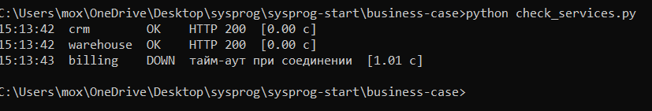
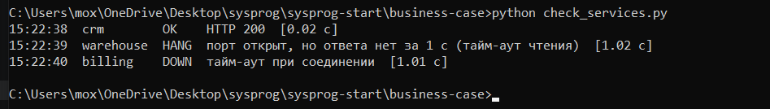
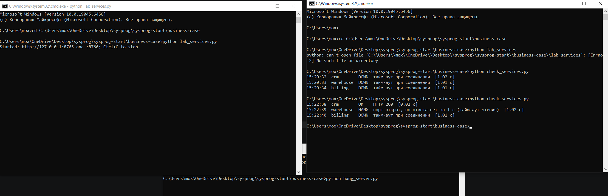
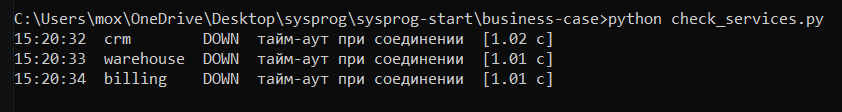

# ЛР 5. Мониторинг доступности сервисов

Система: x64
Программа: свой скрипт check_services.py (Python, только стандартная библиотека), тестовые сервисы — lab_services.py

## Что сделано
Утилита читает services.json и по каждому сервису делает две проверки: сначала просто открывает TCP-соединение на адрес и порт, потом шлёт HTTP GET и смотрит на ответ. Каждая строка пишется на экран и в check.log с временем и длительностью. Тайм-аут берётся из services.json (1 с). Если всё в порядке, код возврата 0, если что-то не так — 1.

Состояния:
- OK — порт открылся, пришёл HTTP 2xx
- DOWN — соединение не установилось: порт закрыт (connection refused) или тайм-аут
- HANG — соединение есть, а ответа за тайм-аут нет
- BAD — ответ пришёл, но не 2xx (например 503)

## Проверки
Запуск: `python lab_services.py` в одном окне, `python check_services.py` в другом.

| № | Что делал | crm (8765) | warehouse (8766) | billing (8767) |
|---|-----------|-----------|------------------|----------------|
| 1 | всё как есть | OK, HTTP 200 | OK, HTTP 200 | DOWN, тайм-аут при соединении |
| 2 | warehouse → /error | OK | BAD, HTTP 503 | DOWN |
| 3 | warehouse → /slow | OK | HANG, нет ответа за 1 с | DOWN |
| 4 | warehouse → порт, который принимает соединение и молчит | OK | HANG, нет ответа за 1 с | DOWN |
| 5 | выключил lab_services.py целиком | DOWN | DOWN | DOWN |

Пример вывода (пункт 3):

```
15:15:26  crm        OK    HTTP 200  [0.01 с]
15:15:27  warehouse  HANG  порт открыт, но ответа нет за 1 с (тайм-аут чтения)  [1.02 с]
15:15:28  billing    DOWN  тайм-аут при соединении  [1.01 с]
```

## Что отличается
- Порт закрыт (8767): на этом компьютере (Windows) отказ не мгновенный, скрипт ждёт весь тайм-аут 1 с и пишет «тайм-аут при соединении». Сервис при этом не запущен вообще. На Linux тот же скрипт сразу пишет «connection refused», но для мониторинга итог один: DOWN.
- HTTP 503 (/error): ответ быстрый, сервер живой, но говорит, что работать не может. Это уже не «нет связи», а ошибка самого приложения.
- Тайм-аут (/slow): порт открыт, запрос принят, но ответ дольше 1 с. Падает ровно на значении тайм-аута. Сервис /slow отвечает через 3 с, так что с тайм-аутом 5 с он бы прошёл.
- Соединение есть, ответа нет (пункт 4): TCP-рукопожатие проходит, а приложение молчит. Проверка «порт открыт» тут показала бы зелёное, и только HTTP-запрос показал, что сервис не работает.

## Вывод
Ping и проверка порта говорят только о том, что сервер включён и что-то слушает порт. Сервис при этом может отвечать 503 или вообще не отвечать. Поэтому в мониторинге нужна проверка уровня приложения: реальный запрос, код ответа и тайм-аут. Отдельно полезно различать «порт закрыт», «тайм-аут» и «503», потому что чинить их надо по-разному (поднять сервис, разбираться с нагрузкой или зависанием, смотреть логи приложения).

Не получилось: различить «порт закрыт» и «тайм-аут соединения» на Windows, потому что обе ситуации выглядят одинаково (DOWN через 1 с). Ещё в окне lab_services.py при /slow вылезает ConnectionAbortedError: это проверялка сама оборвала соединение по тайм-ауту, сервис тут ни при чём.

## Снимки экрана

Сохраните снимок поверх заглушки в папке `screenshots/` с тем же именем — ссылки ниже менять не нужно.

### 1. Всё как есть
Шаг 1. Видно: crm и warehouse OK, billing DOWN (на порту никто не слушает).



### 2. Ответ 503
Шаг 2. Видно: warehouse → /error, статус BAD, HTTP 503.



### 3. Медленный ответ
Шаг 3. Видно: warehouse → /slow, статус HANG, ожидание 1 с.


### 4. Порт открыт, ответа нет
Шаг 4. Видно: соединение установилось, ответа нет, статус HANG.



### 5. Всё выключено
Шаг 5. Видно: все три сервиса DOWN, потому что lab_services.py выключен.


