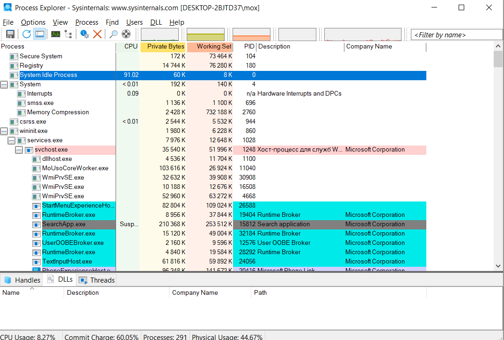
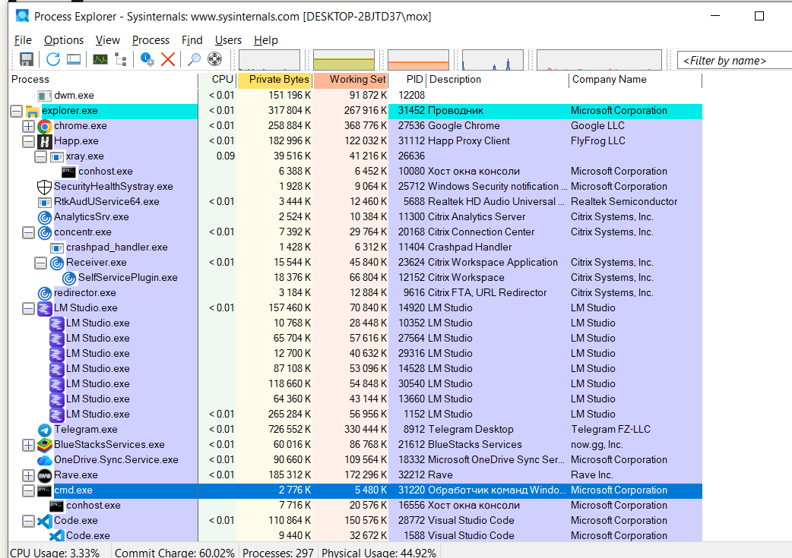
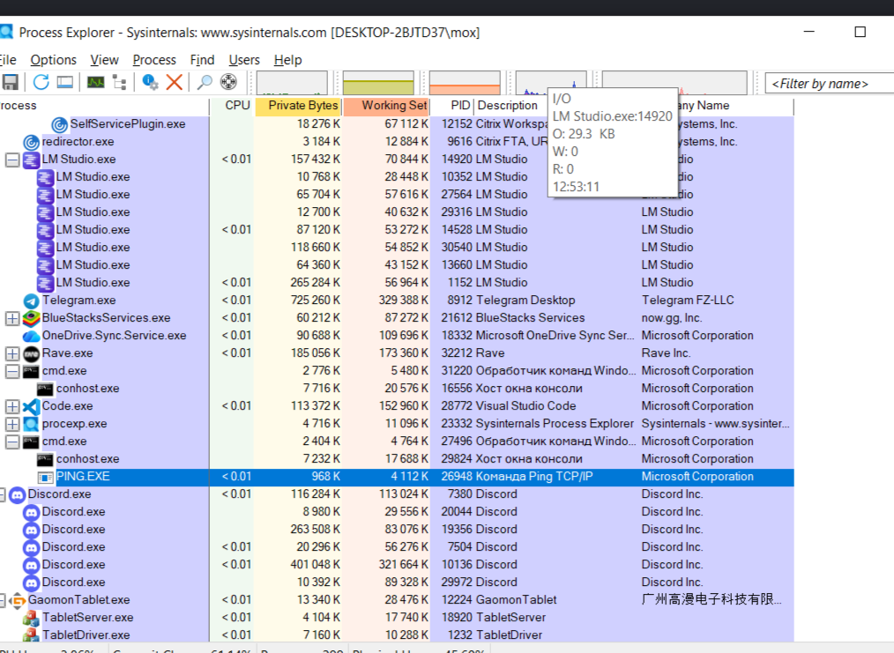
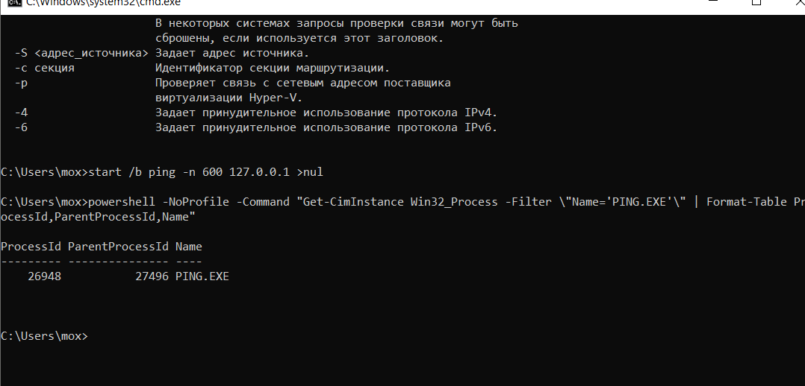
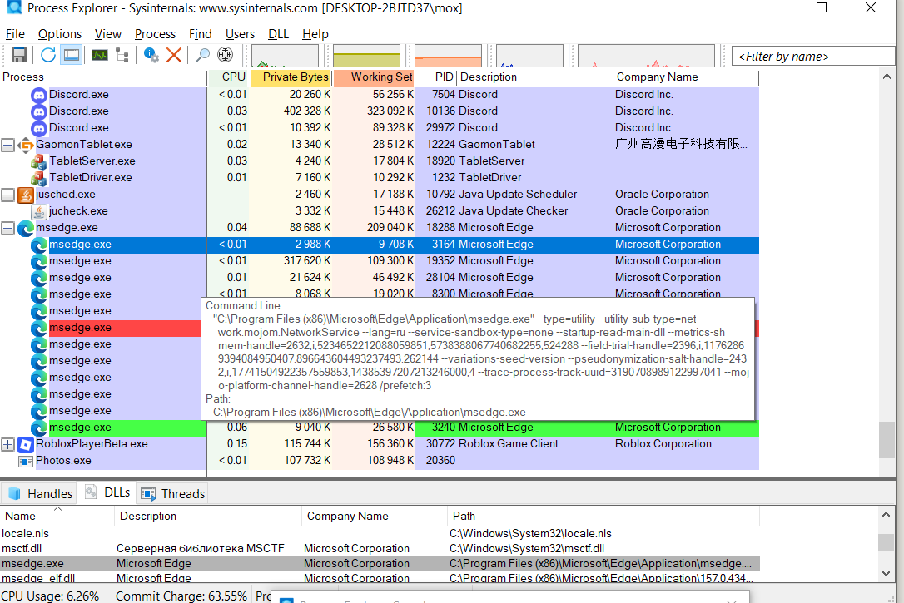
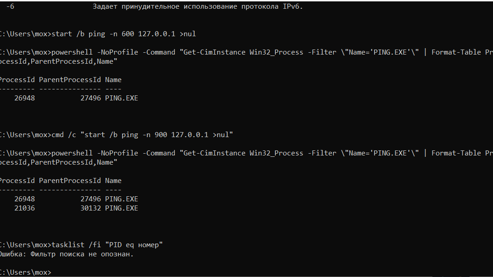
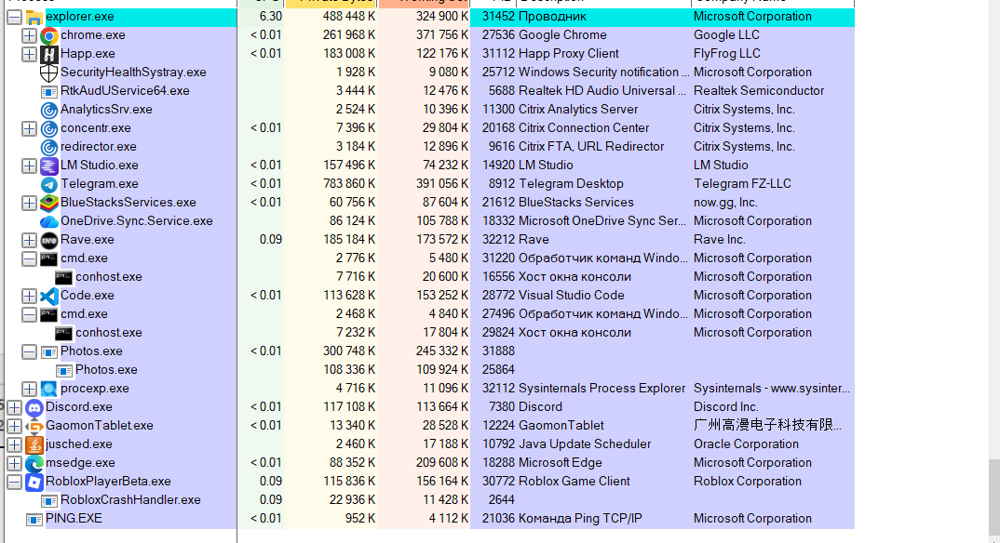

# ЛР 4. Дерево процессов

Система: x64

## Дерево
Процесс в начале дерева и его номер: System Idle Process, PID 0 (далее System, PID 4)
Цепочка родителей терминала (имя и номер): cmd.exe (31220) ← explorer.exe (31452); у cmd.exe дочерний conhost.exe (29824)
Дочерний процесс: номер 26948, родитель 27496
Команда, которой проверен родитель: powershell -NoProfile -Command "Get-CimInstance Win32_Process -Filter \"Name='PING.EXE'\" | Format-Table
Процессов у браузера и имя процесса вкладок: 12 дочерних процессов у главного msedge.exe (PID 18288); процессы вкладок называются msedge.exe, их отличает параметр --type=renderer в командной строке

## Сирота
Номер сироты: 21036
Номер родителя до и после завершения настоящего родителя: 21036
Где сирота стоит в дереве: у левого края, без родителя: процесс с номером его родителя уже завершился

Не получилось: все получилось

## Снимки экрана

Сохраните снимок поверх заглушки в папке `screenshots/` с тем же именем — ссылки ниже менять не нужно.

### 1. Начало дерева процессов
Шаг 1. Видно: дерево процессов в мониторе: первые процессы системы и их номера.

### 2. Терминал и его родители
Шаг 2. Видно: ветка дерева от процесса терминала вверх до процесса системы.

### 3. Дочерний процесс терминала
Шаг 3. Видно: запущенный из терминала процесс под оболочкой терминала.

### 4. Родитель по команде
Шаг 4. Видно: вывод команды с номером процесса и номером его родителя.

### 5. Процессы браузера
Шаг 5. Видно: раскрытая ветка браузера с дочерними процессами.

### 6. Процесс без родителя
Шаг 6. Видно: команда запуска и номер родителя у оставшегося процесса.

### 7. Сирота в дереве
Шаг 7. Видно: тот же процесс в дереве монитора на новом месте.

