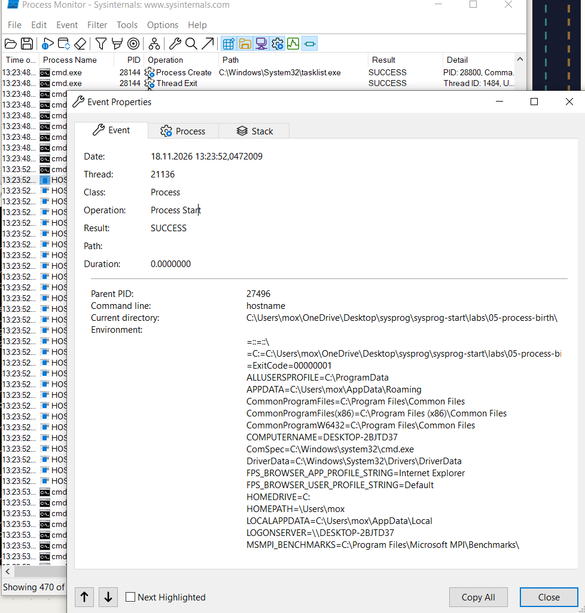
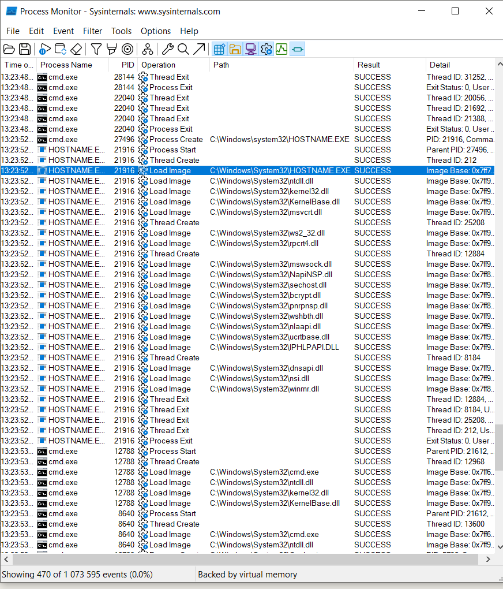
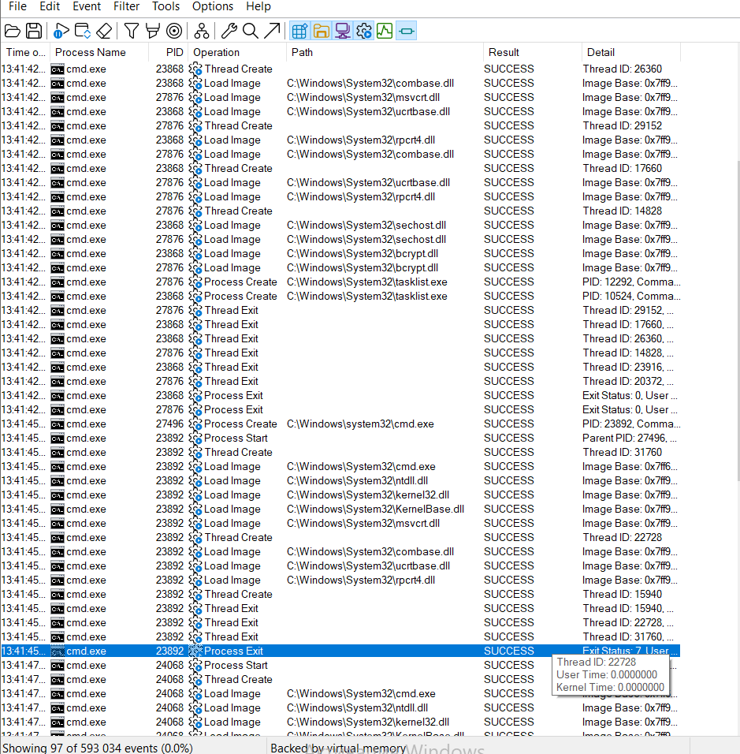
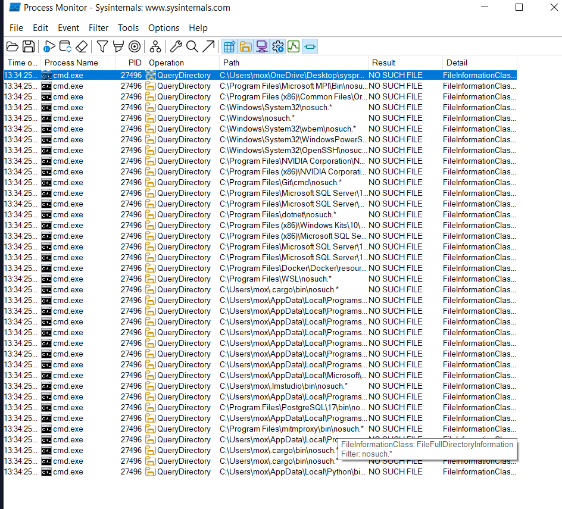
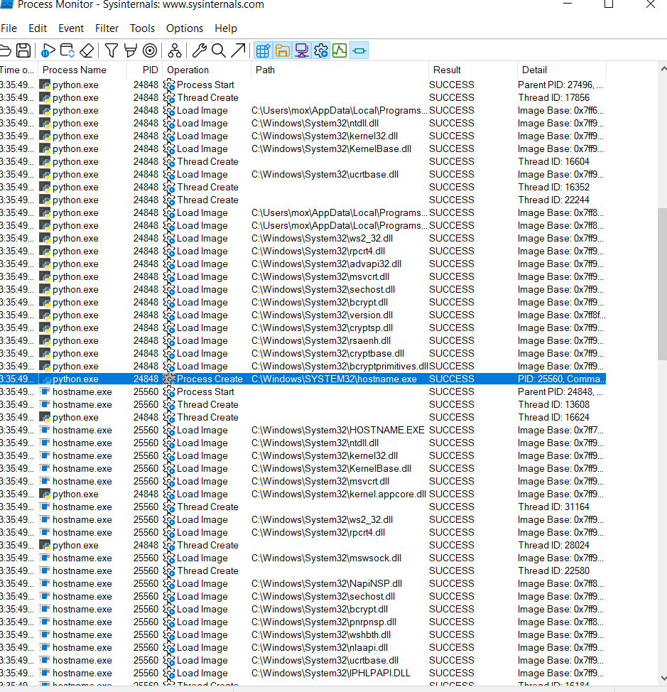

# ЛР 5. Рождение процесса

Система: x64
Программа записи: Process Monitor (Sysinternals)

## Рождение
Родитель (имя и номер): cmd.exe, PID 27496 
Номер нового процесса: 21916
Событие или вызов, которым создан процесс:  событие Process Create у родителя (системный вызов CreateProcessW), у ребёнка Process Start с Parent PID
Библиотек загружено и первая из них: 18 библиотек; первой загружена ntdll.dll

## Завершение
Код завершения у ребёнка и у родителя:  ребёнка Exit Status: 7 (Process Exit), у родителя %errorlevel% = 7 (echo code 7)
Программа nosuch: папок проверено папок проверено 38, ошибка NO SUCH FILE (в Win32: ERROR_FILE_NOT_FOUND, 2), код 9009

## Запуск из Python
Номер Python и номер ребёнка: python.exe 24848, hostname.exe 25560
Чем запуск из Python отличается от запуска из оболочки: ничем по сути: subprocess.run подаёт ядру ту же заявку CreateProcessW; отличается только родитель (python.exe вместо cmd.exe), а код завершения 0 Python забирает через returncode

Не получилось: не получалось найти Exit Status 7

## Снимки экрана

Сохраните снимок поверх заглушки в папке `screenshots/` с тем же именем — ссылки ниже менять не нужно.

### 1. Рождение процесса
Шаг 1. Видно: запись запуска `hostname`: родитель создаёт процесс, у нового процесса номер родителя.

### 2. Библиотеки нового процесса
Шаг 2. Видно: библиотеки, которые загрузил `hostname`, и первая из них.

### 3. Код завершения 7
Шаг 3. Видно: завершение ребёнка с кодом 7 и тот же код у родителя.

### 4. Программы нет
Шаг 4. Видно: поиск `nosuch` по папкам из PATH и ошибка «не найдено».

### 5. Запуск из Python
Шаг 5. Видно: Python создаёт процесс `hostname`: номер Python и номер ребёнка.

