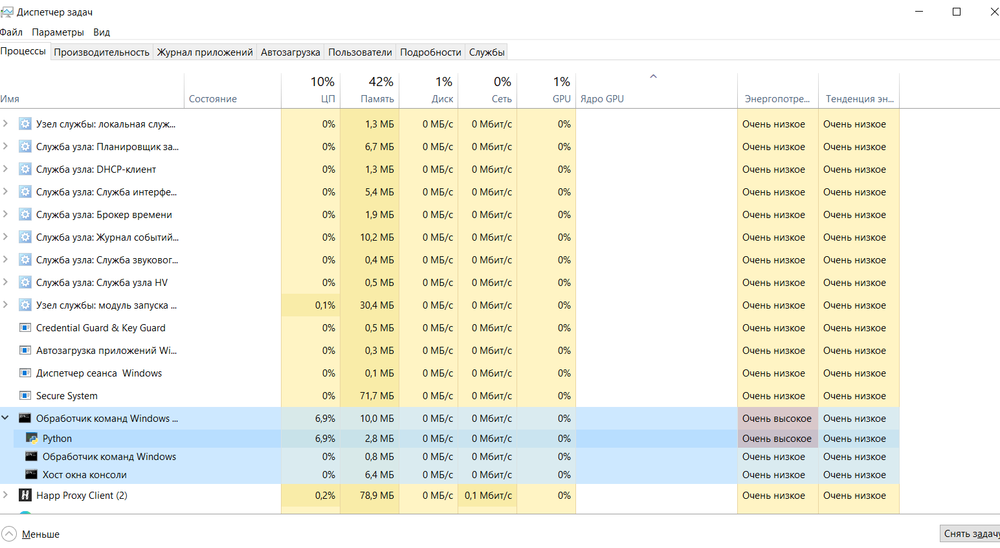
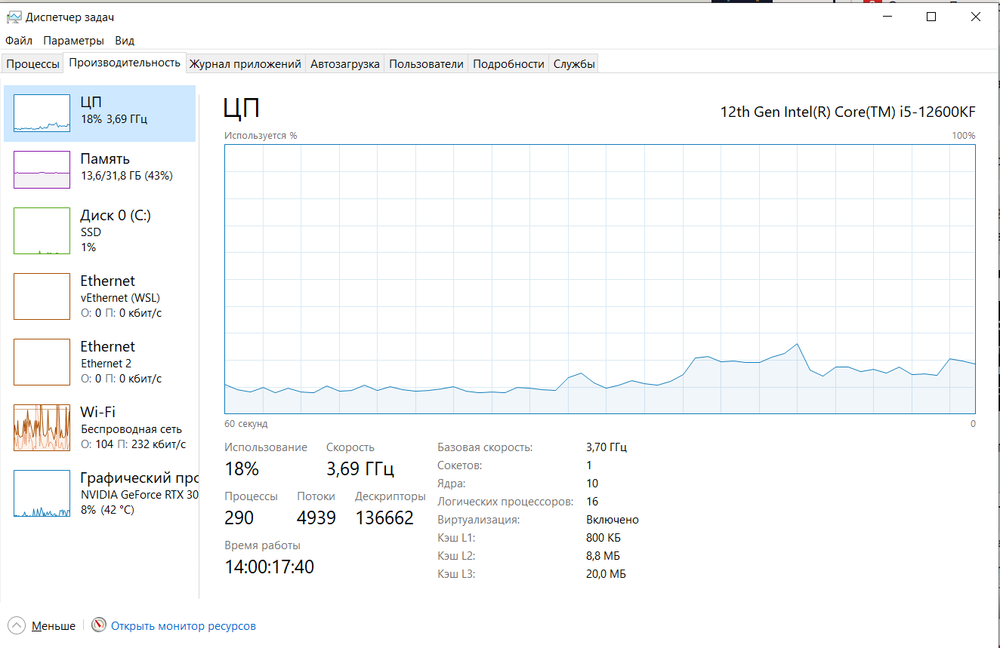
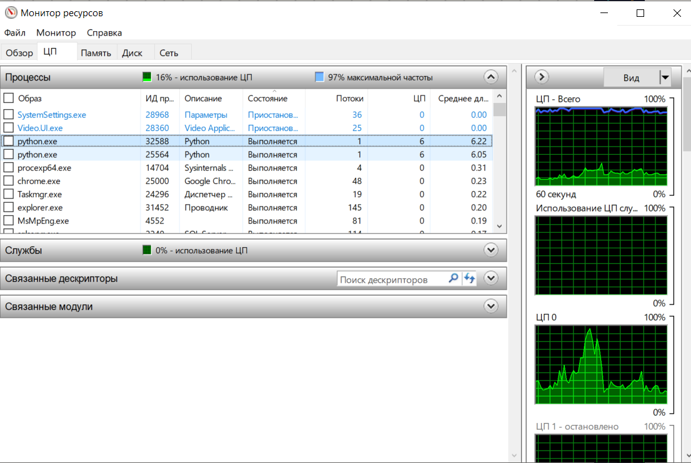
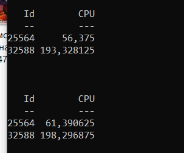

# ЛР 6. Кто загружает процессор

Система: x64
Ядер (логических процессоров): 16

## Одна нагрузка
Процент процесса в мониторе: 6,9% (Python в Диспетчере задач)
Общая загрузка: 10%
На каких ядрах видна нагрузка: на ядре 0 (график «ЦП 0» в Мониторе ресурсов); нагрузка идёт всплесками, ровной полосы на 100% нет: планировщик пересаживает программу между ядрами

## Две нагрузки
Проценты обеих нагрузок и общая загрузка: python.exe 32588 — 6% (среднее 6,22), python.exe 25564 — 6% (среднее 6,05); общая загрузка 18% (Диспетчер задач)
На одном ядре (в macOS — фоновый режим): программы делят ядро 0 пополам.

## Процессорное время
Первый замер, второй замер, пауза: процесс 25564: 56,375 с и 61,390625 с; процесс 32588: 193,328125 с и 198,296875 с; пауза 5 с
Загрузка по замерам: 25564 — (61,390625 − 56,375) / 5 ≈ 1,00 (около 100% одного ядра); 32588 — (198,296875 − 193,328125) / 5 ≈ 0,99 (около 99% одного ядра)
Почему процент в мониторе не говорит о скорости работы: процент показывает только долю времени, когда ядро занято программой, а не объём сделанной работы. Ядра бывают быстрыми и медленными (у Core i5-12600KF есть производительные и экономичные ядра), а частота меняется: в Мониторе ресурсов видно «122% максимальной частоты». Поэтому те же проценты на разных ядрах означают разную скорость.

Не получилось: все получилось

## Снимки экрана

Сохраните снимок поверх заглушки в папке `screenshots/` с тем же именем — ссылки ниже менять не нужно.

### 1. Одна нагрузка
Шаг 1. Видно: процесс Python в мониторе: его процент и общая загрузка.

### 2. Две нагрузки
Шаг 3. Видно: два процесса Python и загрузка ядер.

### 3. Нагрузки на одном ядре
Шаг 4. Видно: две нагрузки на одном ядре и их проценты; в macOS — два числа оборотов цикла.

### 4. Процессорное время
Шаг 5. Видно: два замера процессорного времени с паузой между ними.

