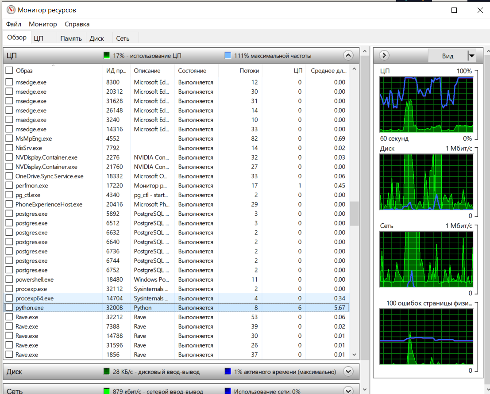
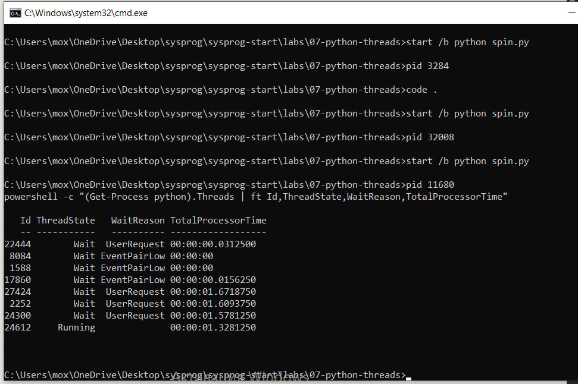
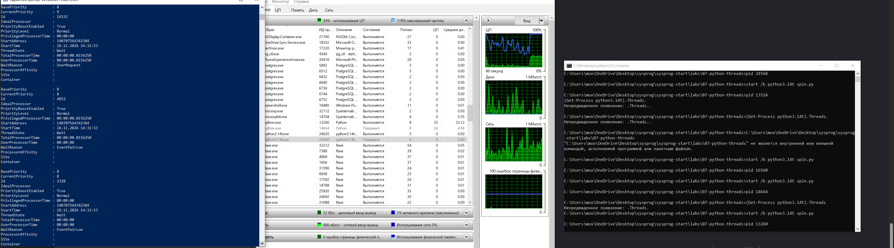
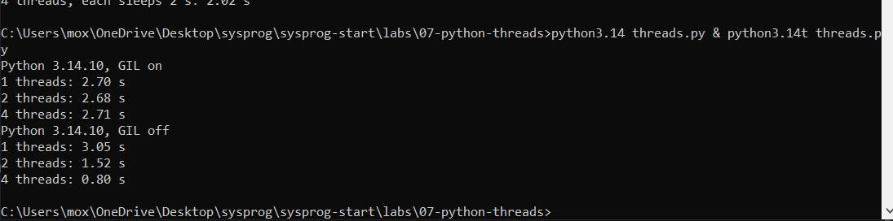

# ЛР 7. Потоки Python и GIL

Система: x64
Ядер (логических процессоров): 16
Версии Python (обычный и без GIL): 3.14.10 и 3.14.10 (free-threaded, 3.14t)

## Python с GIL
Процент процесса и число потоков: 6% (1 логический процессор из 16), 8 потоков
Сколько потоков выполняется одновременно: 1 (из 4 рабочих: 1 Running, 3 Wait)

## Python без GIL
Процент процесса и проценты потоков: 25% (4 из 16 логических процессоров); у всех 4 рабочих потоков состояние Running, время процессора почти одинаковое: 10,53 / 10,58 / 10,56 / 10,53 с. Остальные 4 потока служебные (Wait, время около 0). Все четыре рабочих выполняются одновременно, каждый на своём ядре.
## Время работы
С GIL, 1 / 2 / 4 потока: 2,70 / 2,68 / 2,71 с
Без GIL, 1 / 2 / 4 потока: 3,05 / 1,52 / 0,80 с (4 потока быстрее в 3,8 раза)
Без GIL с PYTHON_GIL=1: 3,07 / 3,04 / 3,05 с
Ожидание, 1 и 4 потока: 2,01 / 2,02 с
Почему ожидающие потоки ускоряются и с GIL: Поток, который ждёт сеть или диск, отдаёт GIL, поэтому остальные потоки в это время работают, а все ожидания идут одновременно.

Не получилось: все получилось

## Снимки экрана

Сохраните снимок поверх заглушки в папке `screenshots/` с тем же именем — ссылки ниже менять не нужно.

### 1. Четыре потока с GIL
Шаг 1. Видно: процесс Python в мониторе: его процент и число потоков.

### 2. Потоки процесса
Шаг 2. Видно: список потоков процесса: сколько выполняется, сколько ждёт.

### 3. Четыре потока без GIL
Шаг 3. Видно: процесс python3.14t в мониторе: его процент.

### 4. Время работы
Шаг 4. Видно: вывод threads.py в Python с GIL и без.

