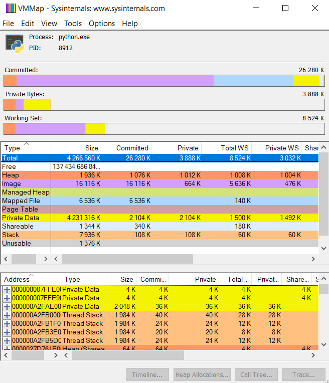
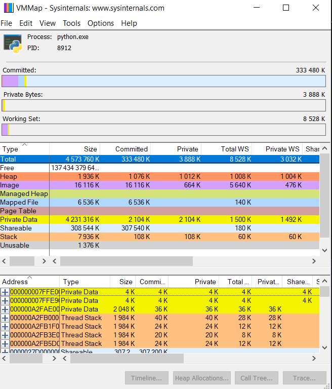
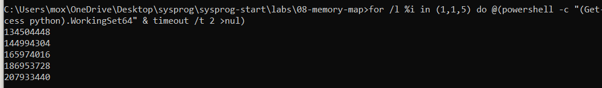

# ЛР 8. Карта памяти

Система: x64
Чем мерил (виртуальная и занятая): PowerShell Get-Process (VirtualMemorySize64 — обещано, WorkingSet64 — занято) и VMMap (Committed — обещано, Working Set — занято)

## Этапы mem.py
Старт: обещано (Committed) 26 280 K ≈ 26 МБ, занято (Working Set) 8 524 K ≈ 8 МБ; в PowerShell: VirtualMemorySize64 4 367 548 416 Б ≈ 4,07 ГБ, WorkingSet64 8 720 384 Б ≈ 8 МБ
Получил 300 МБ:  обещано 333 480 K (выросло на 307 200 K = 300 МБ), занято 8 528 K (почти не изменилось)

Записал в каждую страницу: Записал в каждую страницу: обещано (VirtualMemorySize64) 4 676 026 368 Б ≈ 4,35 ГБ, занято (WorkingSet64) 323 260 416 Б ≈ 308 МБ

Освободил: Освободил: обещано (VirtualMemorySize64) 4 361 453 568 Б ≈ 4,06 ГБ, занято (WorkingSet64) 8 691 712 Б ≈ 8 МБ (вернулись к стартовым значениям)

Почему занятая память выросла только на третьем этапе: Когда программа просит 300 МБ, система только записывает обещание: выделяет адреса, но не даёт физических страниц. Растёт обещанная память, а занятая нет. Страница занимает оперативную память только при первой записи в неё. На третьем этапе программа записала по единице в каждую страницу, и только тогда занятая память выросла на 300 МБ.

## Карта памяти
Из каких частей состоит память процесса: По VMMap на старте обещано 26 280 K, занято 8 524 K. Части: Image (код Python и библиотек) 16 116 K, Mapped File 6 536 K, Private Data 2 104 K, Heap 1 076 K, Shareable 340 K, Stack 108 K. Больше всего обещано под код Python и библиотек.

## Утечка
Пять замеров leak.py: 134 504 448 / 144 994 304 / 165 974 016 / 186 953 728 / 207 933 440 Б (≈128 / 138 / 158 / 178 / 198 МБ)

На сколько росла память за 2 секунды: ≈20 МБ (между замками 2–5 ровно по 20 979 712 Б; первый шаг ≈10 МБ). Число только растёт и не останавливается: так выглядит утечка.

Не получилось: все получилось

## Снимки экрана

Сохраните снимок поверх заглушки в папке `screenshots/` с тем же именем — ссылки ниже менять не нужно.

### 1. Карта памяти
Шаг 2. Видно: карта памяти процесса mem.py на старте и её итог.

### 2. Получено 300 МБ
Шаг 3. Видно: виртуальная память выросла на 300 МБ, занятая — нет.

### 3. Страницы заняты
Шаг 4. Видно: занятая память (в macOS — физический след) после записи в каждую страницу.

### 4. Утечка
Шаг 6. Видно: пять замеров памяти leak.py.

