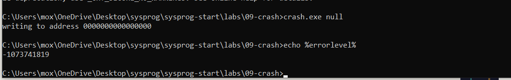
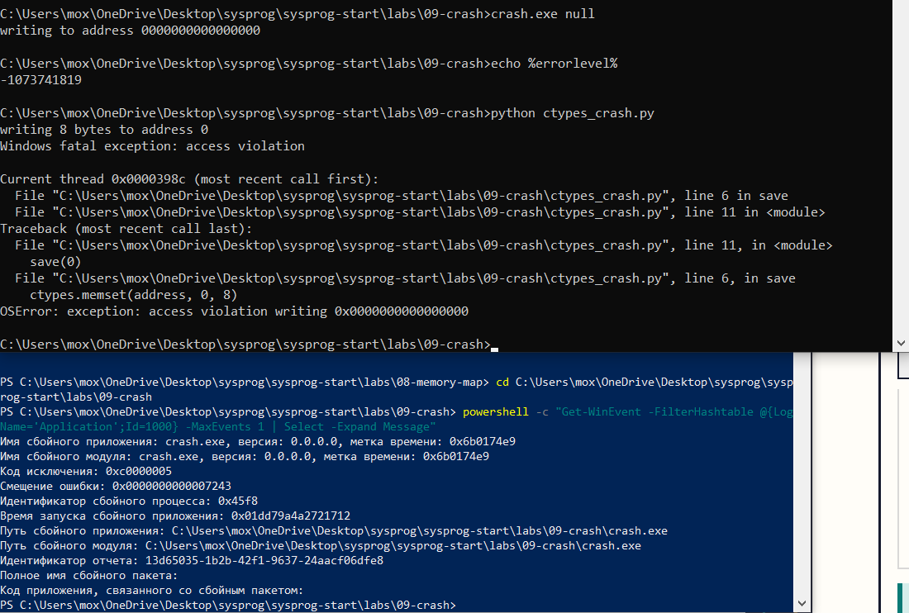
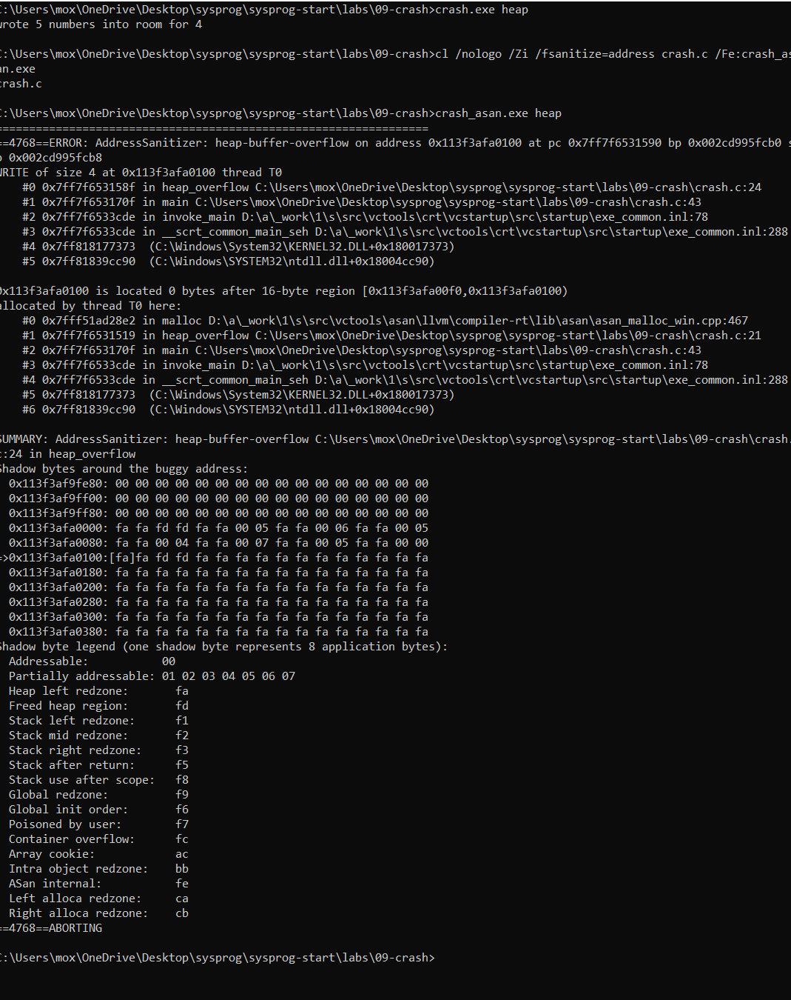
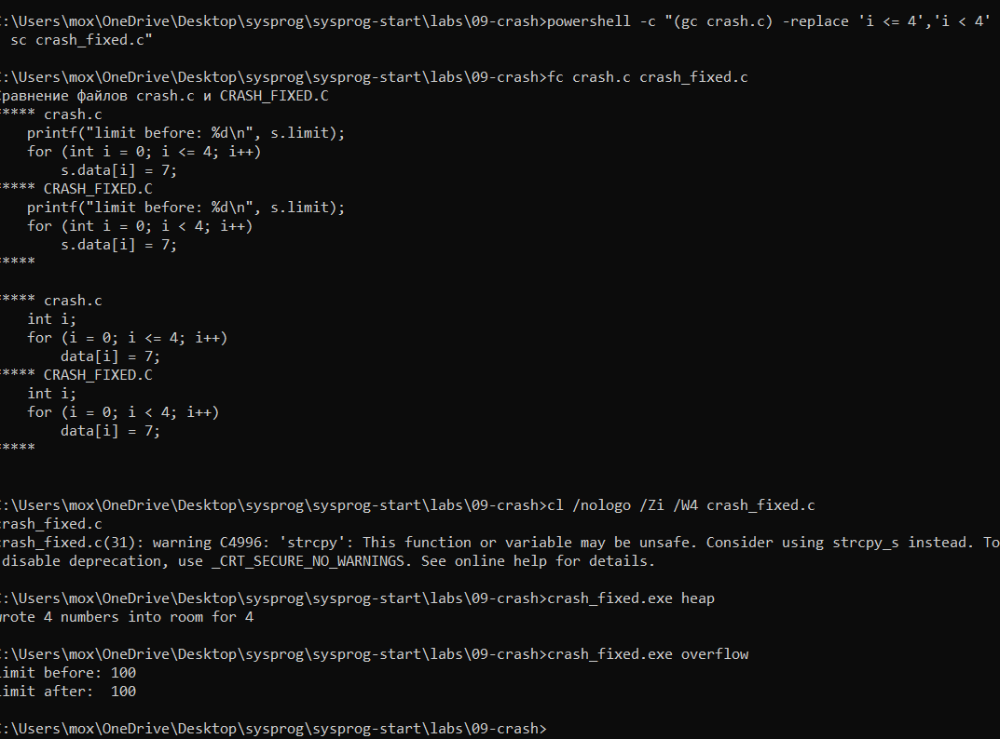

# ЛР 9. Разбор падения

Система: x64
Компилятор:  MSVC (cl) с ключами `/Zi /fsanitize=address`

## Падение
crash null: что напечатано и код завершения: напечатано `writing to address 0000000000000000`; код завершения (`echo %errorlevel%`) = -1073741819 (это 0xC0000005, нарушение доступа)
ctypes_crash.py: что напечатал Python: что напечатал Python: `writing 8 bytes to address 0`, затем `Windows fatal exception: access violation` и traceback (`ctypes.memset(address, 0, 8)` в `save`, строка 6; вызов `save(0)`, строка 11), в конце `OSError: exception: access violation writing 0x0000000000000000`
Где система записала падение: в журнале Windows «Приложение» (Application), событие с ID 1000 (Application Error): сбойное приложение crash.exe, код исключения 0xc0000005, смещение ошибки 0x0000000000007243, сбойный модуль crash.exe

## Молчаливые ошибки
crash overflow: limit до и после, код: limit до и после, код: до: 100, после: 7; код завершения 0 (программа не упала, но значение испорчено)
crash heap без проверки: напечатано `wrote 5 numbers into room for 4` (записано 5 чисел в буфер на 4), программа продолжила работу без видимой ошибки
AddressSanitizer для heap: вид ошибки и строка: вид ошибки и строка: `heap-buffer-overflow`, запись (WRITE) размером 4 байта, `crash.c:24` в функции `heap_overflow` (вызвана из `main`, `crash.c:43`); адрес находится ровно за концом 16-байтового блока, выделенного на `crash.c:21`
AddressSanitizer для uaf: вид ошибки и две строки: вид ошибки и две строки: `heap-use-after-free`, чтение (READ) размером 2 байта в `crash.c:33` (`printf` в `use_after_free`); память освобождена на `crash.c:32` (`free`), а выделена на `crash.c:30` (`malloc`). Без ASan программа просто напечатала `name after free: agent`

## Исправление
Что изменено и что напечатала исправленная программа: ___

Не получилось: все получилось

## Снимки экрана

Сохраните снимок поверх заглушки в папке `screenshots/` с тем же именем — ссылки ниже менять не нужно.

### 1. Падение
Шаг 1. Видно: запуск crash null и код завершения.

### 2. Падение Python
Шаг 2. Видно: вывод ctypes_crash.py и запись системы о падении.

### 3. Отчёт AddressSanitizer
Шаг 4. Видно: вывод crash heap без проверки и с AddressSanitizer (на Windows с ARM — без проверки).

### 4. Исправление
Шаг 6. Видно: разница файлов и вывод исправленной программы.

